# PropAxis relational database schema

The schema is for one residential property-management company. UUID primary
keys and timezone-aware timestamps are used throughout. Money is stored as
`NUMERIC`, status values are enforced with database check constraints, and
uploaded files are represented by storage keys and metadata.

```mermaid
erDiagram
    USERS {
        uuid id PK
        string full_name
        string email UK
        string role
        boolean is_active
        timestamptz created_at
        timestamptz updated_at
    }
    PROPERTY_MANAGER_ASSIGNMENTS {
        uuid id PK
        uuid manager_id FK
        uuid property_id FK
        boolean is_active
    }
    PROPERTIES {
        uuid id PK
        string property_name
        string address
        string city
        string state
        string postal_code
        string property_type
        integer total_units
        string status
    }
    UNITS {
        uuid id PK
        uuid property_id FK
        string unit_number
        integer bedrooms
        numeric area
        numeric monthly_rent
        numeric security_deposit
        string occupancy_status
        string availability_status
    }
    TENANT_PROFILES {
        uuid id PK
        uuid user_id FK,UK
        string emergency_contact_name
        string emergency_contact_phone
    }
    LEASES {
        uuid id PK
        uuid tenant_id FK
        uuid unit_id FK
        date start_date
        date end_date
        numeric monthly_rent
        numeric security_deposit
        string lease_status
    }
    LEASE_DOCUMENTS {
        uuid id PK
        uuid tenant_id FK
        uuid lease_id FK
        string storage_key UK
        string file_name
        string content_type
    }
    PAYMENTS {
        uuid id PK
        uuid tenant_id FK
        uuid lease_id FK
        numeric amount
        string payment_status
        string payment_method
        string gateway_order_id UK
        string gateway_payment_id UK
        string transaction_reference UK
        timestamptz paid_at
    }
    PAYMENT_TRANSACTIONS {
        uuid id PK
        uuid payment_id FK
        numeric amount
        string payment_status
        string gateway_order_id UK
        string gateway_payment_id UK
        string provider_reference UK
    }
    PAYMENT_RECEIPTS {
        uuid id PK
        uuid payment_id FK,UK
        string receipt_reference UK
        string storage_key UK
    }
    MAINTENANCE_REQUESTS {
        uuid id PK
        uuid tenant_id FK
        uuid property_id FK
        uuid unit_id FK
        string category
        string description
        string priority
        string status
        timestamptz submitted_at
        timestamptz completed_at
    }
    MAINTENANCE_ASSIGNMENTS {
        uuid id PK
        uuid maintenance_request_id FK
        string technician_name
        string vendor_name
        string contact_phone
        string contact_email
    }
    MAINTENANCE_UPDATES {
        uuid id PK
        uuid maintenance_request_id FK
        uuid author_id FK
        string previous_status
        string new_status
        string note
    }
    MAINTENANCE_ATTACHMENTS {
        uuid id PK
        uuid maintenance_request_id FK
        uuid uploaded_by_id FK
        string storage_key UK
        string file_name
        string content_type
    }
    ENQUIRIES {
        uuid id PK
        string name
        string email
        numeric budget_min
        numeric budget_max
        string source_channel
        string enquiry_status
        uuid assigned_manager_id FK
        uuid converted_tenant_id FK
    }
    ENQUIRY_PROPERTY_MATCHES {
        uuid id PK
        uuid enquiry_id FK
        uuid property_id FK
        numeric match_score
    }
    PROPERTY_VISIT_REQUESTS {
        uuid id PK
        uuid enquiry_id FK
        uuid property_id FK
        uuid decided_by_id FK
        timestamptz requested_at
        string approval_status
        timestamptz decided_at
    }
    ENQUIRY_FOLLOWUPS {
        uuid id PK
        uuid enquiry_id FK
        uuid created_by_id FK
        string note
        timestamptz created_at
    }
    CONVERSATIONS {
        uuid id PK
        uuid created_by_id FK
        string subject
        string external_reference
        timestamptz created_at
    }
    CONVERSATION_PARTICIPANTS {
        uuid id PK
        uuid conversation_id FK
        uuid user_id FK
        string external_name
        string external_email
        string external_phone
    }
    MESSAGES {
        uuid id PK
        uuid conversation_id FK
        uuid sender_user_id FK
        uuid recipient_user_id FK
        string channel
        string direction
        string delivery_status
        string provider_reference
        boolean is_ai_generated
        boolean human_assistance_requested
        text content
    }
    COMMUNICATION_EVENTS {
        uuid id PK
        uuid conversation_id FK
        string channel
        string event_type
        string provider_reference
        timestamptz occurred_at
    }
    APPROVAL_REQUESTS {
        uuid id PK
        uuid requester_id FK
        uuid assigned_approver_id FK
        uuid property_visit_request_id FK
        uuid related_entity_id
        string approval_type
        string status
        string decision
        timestamptz decided_at
    }
    APPROVAL_ACTIONS {
        uuid id PK
        uuid approval_request_id FK
        uuid actor_id FK
        string action
        string remarks
        timestamptz created_at
    }
    NOTIFICATIONS {
        uuid id PK
        uuid recipient_id FK
        string channel
        string event_type
        string delivery_status
        timestamptz created_at
        timestamptz delivered_at
        timestamptz read_at
    }
    NOTIFICATION_PREFERENCES {
        uuid id PK
        uuid user_id FK
        string channel
        string event_type
        boolean is_enabled
    }
    AUDIT_LOGS {
        uuid id PK
        uuid actor_id FK
        string action
        string entity_type
        uuid entity_id
        json changes
        timestamptz created_at
    }

    USERS ||--o| TENANT_PROFILES : has
    USERS ||--o{ PROPERTY_MANAGER_ASSIGNMENTS : assigned
    PROPERTIES ||--o{ PROPERTY_MANAGER_ASSIGNMENTS : managed_by
    PROPERTIES ||--|{ UNITS : contains
    TENANT_PROFILES ||--o{ LEASES : holds
    UNITS ||--o{ LEASES : history
    TENANT_PROFILES ||--o{ LEASE_DOCUMENTS : owns
    LEASES ||--o{ LEASE_DOCUMENTS : documents
    TENANT_PROFILES ||--o{ PAYMENTS : pays
    LEASES ||--o{ PAYMENTS : billed
    PAYMENTS ||--o{ PAYMENT_TRANSACTIONS : attempts
    PAYMENTS ||--o| PAYMENT_RECEIPTS : receipt
    TENANT_PROFILES ||--o{ MAINTENANCE_REQUESTS : submits
    PROPERTIES ||--o{ MAINTENANCE_REQUESTS : located_at
    UNITS ||--o{ MAINTENANCE_REQUESTS : concerns
    MAINTENANCE_REQUESTS ||--o{ MAINTENANCE_ASSIGNMENTS : assigned_to
    MAINTENANCE_REQUESTS ||--o{ MAINTENANCE_UPDATES : history
    MAINTENANCE_REQUESTS ||--o{ MAINTENANCE_ATTACHMENTS : files
    USERS ||--o{ ENQUIRIES : assigned_manager
    TENANT_PROFILES ||--o{ ENQUIRIES : converted_to
    ENQUIRIES ||--o{ ENQUIRY_PROPERTY_MATCHES : matched
    PROPERTIES ||--o{ ENQUIRY_PROPERTY_MATCHES : match
    ENQUIRIES ||--o{ PROPERTY_VISIT_REQUESTS : requests
    PROPERTIES ||--o{ PROPERTY_VISIT_REQUESTS : visits
    ENQUIRIES ||--o{ ENQUIRY_FOLLOWUPS : followed_up
    USERS ||--o{ CONVERSATIONS : creates
    CONVERSATIONS ||--o{ CONVERSATION_PARTICIPANTS : includes
    USERS o|--o{ CONVERSATION_PARTICIPANTS : participates
    CONVERSATIONS ||--o{ MESSAGES : contains
    USERS o|--o{ MESSAGES : sends
    CONVERSATIONS ||--o{ COMMUNICATION_EVENTS : logs
    USERS ||--o{ APPROVAL_REQUESTS : requests
    USERS o|--o{ APPROVAL_REQUESTS : assigned
    PROPERTY_VISIT_REQUESTS o|--o| APPROVAL_REQUESTS : approved_by
    APPROVAL_REQUESTS ||--o{ APPROVAL_ACTIONS : actions
    USERS o|--o{ APPROVAL_ACTIONS : acts
    USERS ||--o{ NOTIFICATIONS : receives
    USERS ||--o{ NOTIFICATION_PREFERENCES : configures
    USERS o|--o{ AUDIT_LOGS : performs
```

## Important constraints

- A case-insensitive unique index prevents duplicate user email addresses.
- Property/unit numbers, manager/property assignments, enquiry matches, and
  tenant/unit/lease-start combinations are unique.
- A partial unique index allows only one `ACTIVE` lease per unit while retaining
  expired and terminated lease history.
- Maintenance requests use a composite foreign key to guarantee the selected
  unit belongs to the selected property.
- A `PROPERTY_VISIT` approval requires its visit request, which is an explicit
  foreign-key relationship. New visits default to `PENDING`.
- Payment gateway order/payment IDs and transaction references are unique.
- Payment and audit records are not deleted through parent cascades.
- Role checks and property-manager authorization are application/service-layer
  responsibilities; the schema stores assignments and roles without trusting
  caller-supplied role headers.
- `approval_requests.related_entity_id` and `audit_logs.entity_id` are
  polymorphic references; the visit-specific approval also has a strict FK.

## Table inventory

`users`, `property_manager_assignments`, `properties`, `units`,
`tenant_profiles`, `leases`, `lease_documents`, `payments`,
`payment_transactions`, `payment_receipts`, `maintenance_requests`,
`maintenance_assignments`, `maintenance_updates`, `maintenance_attachments`,
`enquiries`, `enquiry_property_matches`, `property_visit_requests`,
`enquiry_followups`, `conversations`, `conversation_participants`, `messages`,
`communication_events`, `approval_requests`, `approval_actions`,
`notifications`, `notification_preferences`, `audit_logs`.
